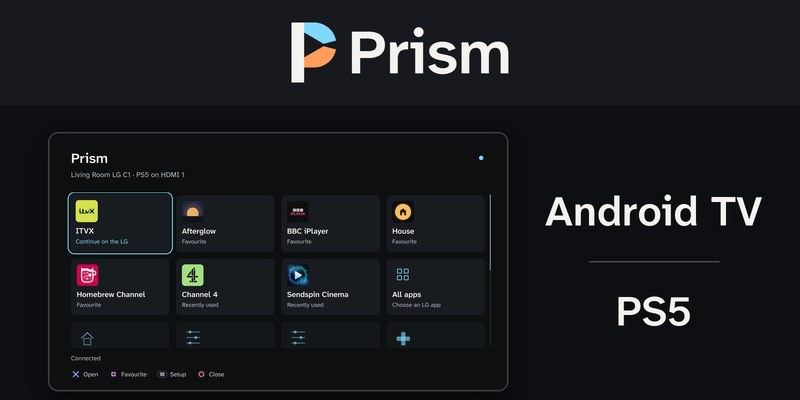
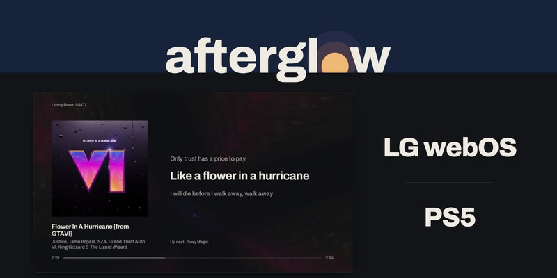
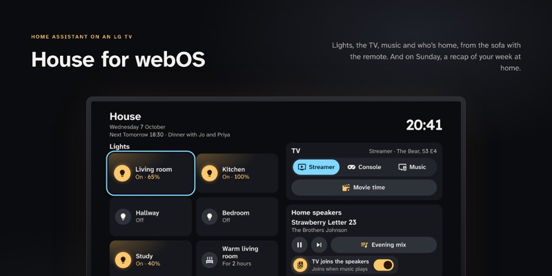
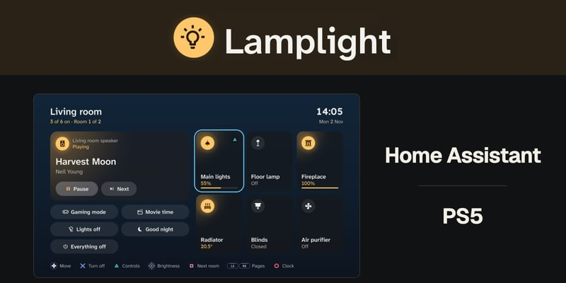
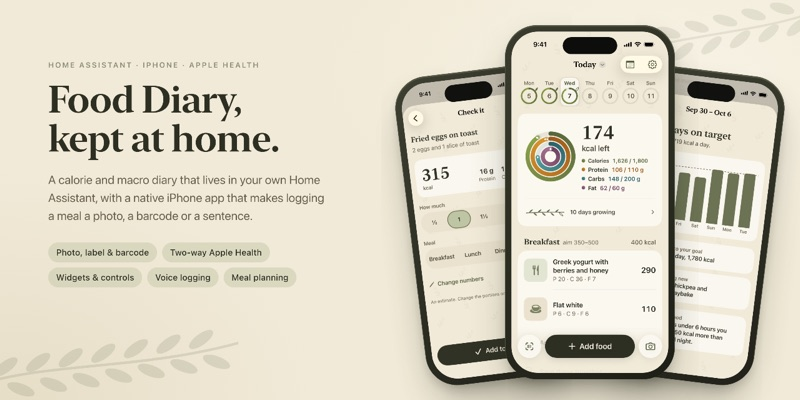
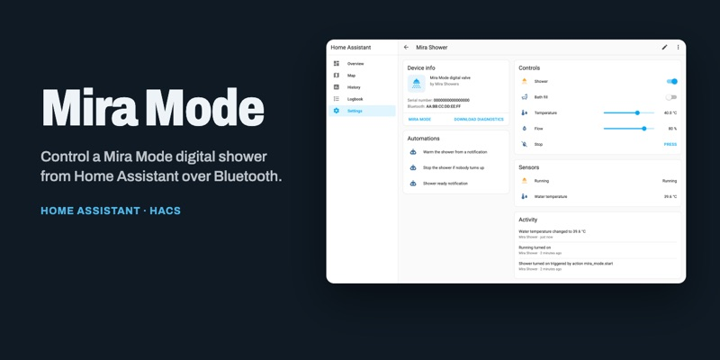

### Hi, I'm Hayden

CTO at [PayMidas](https://paymidas.eu), building payments infrastructure, escrow and regulated fintech in Europe. Before that, eight years of full-stack products for SaaS, fintech and IoT companies.

Client work is private, so this profile is mostly what I build at home: apps for the TV and the software that runs the house. All of it is free and open source.

#### For the TV

<table>
  <tr>
    <td width="33%" valign="top">
      
      <b><a href="https://github.com/HaydenGriffin/prism">PRISM</a></b> 
      <a href="https://github.com/HaydenGriffin/prism/releases/latest">Android TV v1.0.1</a> · <a href="https://github.com/HaydenGriffin/prism-ps5/releases/latest">PS5 v1.0.1</a> 
      One remote for an LG TV, from an <a href="https://github.com/HaydenGriffin/prism">Android TV box</a> or a <a href="https://github.com/HaydenGriffin/prism-ps5">PS5</a>: the box's remote or a DualSense drives LG apps, with an LG launcher and quick TV settings.
    </td>
    <td width="33%" valign="top">
      
      <b><a href="https://github.com/HaydenGriffin/afterglow">Afterglow</a></b> 
      <a href="https://github.com/HaydenGriffin/afterglow/releases/latest">LG webOS v1.6.1</a> · <a href="https://github.com/HaydenGriffin/afterglow-ps5/releases/latest">PS5 v1.7.0</a> 
      A Music Assistant player for <a href="https://github.com/HaydenGriffin/afterglow">LG TVs</a> and the <a href="https://github.com/HaydenGriffin/afterglow-ps5">PS5</a>: album-art posters, word-by-word lyrics and MilkDrop visuals. <a href="https://haydengriffin.github.io/afterglow/">Live demo</a>.
    </td>
    <td width="33%" valign="top">
      
      <b><a href="https://github.com/HaydenGriffin/house-webos">House for webOS</a></b> 
      <a href="https://github.com/HaydenGriffin/house-webos/releases/latest">LG webOS v1.5.0</a> 
      A Home Assistant panel for LG TVs, made for the remote, with a Wrapped-style recap of the week at home. <a href="https://haydengriffin.github.io/house-webos/">Live demo</a>.
    </td>
  </tr>
</table>

#### For the home

<table>
  <tr>
    <td width="33%" valign="top">
      
      <b><a href="https://github.com/HaydenGriffin/lamplight">Lamplight</a></b> 
      <a href="https://github.com/HaydenGriffin/lamplight/releases/latest">Home Assistant v1.2.1</a> · <a href="https://github.com/HaydenGriffin/lamplight-ps5/releases/latest">PS5 v1.1.0</a> 
      A design system for <a href="https://github.com/HaydenGriffin/lamplight">Home Assistant wall tablets</a>, six cards built on it, and the same pages on the TV from a <a href="https://github.com/HaydenGriffin/lamplight-ps5">PS5</a>. <a href="https://haydengriffin.github.io/lamplight/">Live demo</a>.
    </td>
    <td width="33%" valign="top">
      
      <b><a href="https://github.com/HaydenGriffin/ha-food-diary">Food Diary</a></b> 
      <a href="https://github.com/HaydenGriffin/ha-food-diary/releases/latest">v1.6.1</a> 
      A calorie and nutrition diary for Home Assistant, with a native SwiftUI iPhone app, widgets and two-way Apple Health sync.
    </td>
    <td width="33%" valign="top">
      
      <b><a href="https://github.com/HaydenGriffin/ha-mira-mode">Mira Mode</a></b> 
      <a href="https://github.com/HaydenGriffin/ha-mira-mode/releases/latest">v0.2.0</a> 
      A Home Assistant integration for Mira Mode digital showers over Bluetooth LE.
    </td>
  </tr>
</table>

**Also:** [ps5-autojb](https://github.com/HaydenGriffin/ps5-autojb) keeps a jailbroken PS5 ready with nobody at the console, and brings it back after a crash, through Home Assistant.

**Elsewhere:** [haydengriffin.github.io](https://haydengriffin.github.io) · [LinkedIn](https://www.linkedin.com/in/hayden-griffin-65b66612b)

If something here made your setup better, you can [buy me a coffee](https://buymeacoffee.com/haydengriffin).
